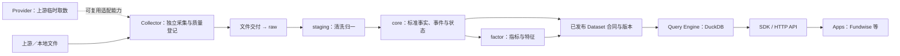

# MarketDB 能力模型与角色边界

状态：能力规划；2026-10-05。

[文档入口](README.md) · [四层架构](logical-architecture.md) · [存储与发布](storage-and-publication.md)

## 1. 定位

MarketDB 接收来源数据文件，完成清洗、标准化、事实与状态维护、指标计算和版本发布，通过统一的数据资产及查询能力服务下游应用。

本文件定义能力角色，不要求每个角色成为独立服务、代码仓库或部署单元。raw／staging／core／factor 描述数据处理层次；Provider／Collector／Dataset／Query Engine／SDK/API／Apps 描述职责与使用关系，两者相互配合。

## 2. 角色定义与本期边界

| 角色 | 定义 | MarketDB 中的定位 | 示例 | 当前阶段 |
| --- | --- | --- | --- | --- |
| Provider | 提供上游接口、参数、字段及临时取数能力；默认不持久化业务数据 | 数据来源能力，位于当前 MarketDB 导入边界之外；其身份与接口信息进入来源记录 | 临时请求 TDX 行情、证券目录或公司资料 | 复用已有来源，不在本期建设 MarketDB Provider 层 |
| Collector | 执行采集任务，产出数据文件并登记运行与质量信息 | 保留采集能力的位置；本期由外部生产流程完成，向 raw 交付文件包 | 采集日线，写 Parquet 并交付范围、单位、来源日期和完整性信息 | 暂不展开实现，也不要求当前调度直接接入；未来接入仍遵守文件交付合同 |
| Dataset | 有名称和合同的数据资产，明确字段、业务键、日期语义、单位、覆盖及版本 | core／factor 对外数据产品的组织单位；内部 raw／staging 也可登记为内部数据集，但不自动开放为稳定公共资产 | `daily`、`trade_cal`、`security_directory`、`st_events`、`daily_state` | 先定义资产与语义，名称为候选，字段和业务键后续冻结 |
| Query Engine | 在已导入、已发布的数据及版本上执行筛选、关联与聚合 | 以 DuckDB 统一查询内部表与发布清单引用的 Parquet | 查询证券某段历史行情，关联当日 ST 状态 | 不因查询自动采集、修复或推进发布 |
| SDK / HTTP API | 为调用方提供本地程序与远程服务访问通道 | 对同一 Dataset、查询语义和质量状态提供一致访问；本地 SDK 可走受控引擎或服务 | Python 按证券与日期读取 `daily`；远程服务执行同一查询 | 接口形式及实现待设计，不宣称已有 MarketDB 公共接口 |
| Apps | 使用数据完成研究、决策支持和业务功能的应用 | 位于 MarketDB 消费侧；不拥有 MarketDB 的来源事实和发布职责 | Fundwise、Notebook、回测、Dashboard、业务服务 | **Fundwise 后续作为 MarketDB App 接入**，本期不执行迁移 |

Collector 暂时保留角色和交付边界即可。MarketDB 的 raw 导入任务不因此改名为 Collector：前者验收已有文件，后者从上游采集并生产文件。

## 3. 能力关系

Provider 与 Collector 是独立能力；Collector 不要求存在对应 Provider 接口，也不要求调用临时请求网关。图中的 Provider 关系是可选复用，不是强制运行链路。

本期 MarketDB 从文件交付开始。Provider 和 Collector 在图中用于说明来源链路，不表示 MarketDB 已经接管这些组件。文件也可由已有发布包或人工受控导出产生，只要满足 raw 交付合同。

查询引擎读取的是 Dataset 当前授权可用的发布版本，不是任意扫描文件目录。SDK/API 负责暴露稳定语义；App 无需依赖 DuckDB 表名、Parquet 文件路径或 staging 结构。

## 4. Dataset 合同

一个 Dataset 至少需要明确以下内容：

| 合同部分 | 需要明确的语义 |
| --- | --- |
| 身份与用途 | 数据集名称、业务对象、所属 core／factor、适用消费者 |
| 结构与唯一性 | 字段类型、业务键、重复及更正处理；业务键不等于已经实现数据库约束 |
| 日期与口径 | 行情日期、报告期、事件生效日、观察时间等区别；单位、币种、复权尺度 |
| 来源与依赖 | raw 来源／批次、标准化规则、core 版本、计算规则及上游 factor 依赖 |
| 范围与质量 | 市场、证券、日期覆盖；完整、部分、未知、过期和不可计算等状态 |
| 发布与读取 | 版本、就绪条件、默认版本选择、日期过滤、字段投影及结果顺序 |
| 修订与保留 | 历史更正方式、影响范围、保留窗口、旧版本是否可重读 |

Dataset 不等于一张表或一个文件。它可以由 DuckDB 内部表、Parquet 集合或受控视图实现；对外合同稳定，物理布局可在兼容条件下调整。

## 5. 初步数据资产目录

以下是逻辑候选名称，不是已发布接口列表。

| 候选 Dataset | 层次 | 核心维度与口径 | 主要消费者用途 |
| --- | --- | --- | --- |
| `security_directory` | core | 证券身份×目录观察／成员版本；当前名称和板别 | 选取候选范围 |
| `trade_cal` | core | 市场×日期×会话状态及覆盖 | 交易日窗口 |
| `daily` | core | 证券×行情日期；标准未复权 OHLCV与金额 | 历史行情、回测及指标输入 |
| `fundamentals` | core | 证券×报告期／统计日×资料类型；不同日期语义明确 | 基本面查询与筛选，必要时拆为独立资产 |
| `share_capital` | core | 证券×有效日期×股本类型 | 换手率、市值计算依据 |
| `st_events`、`listing_events`、`suspension_events` | core | 证券×事件及其有效时间／修订关系 | 风险与生命周期查询 |
| `corporate_actions` | core | 证券×经济事件及生效日；权威来源与参数 | 复权和参考价依据 |
| `etf_source_factors` | core | ETF×日期×来源基准 | ETF 复权依据 |
| `board_members` | core | 板块×证券×成员版本／适用日期 | 板块范围查询与历史聚合 |
| `daily_state` | core | 证券×日期×输入／规则版本；ST、交易、上市阶段及计算就绪 | 状态过滤及结果解释；保留窗口明确 |
| `adjustment_factors`、`adjusted_daily` | factor | 证券×日期×计算版本／价格基准 | 复权行情和后续指标 |
| `technical_features` | factor | 证券／指数×日期×周期×指标口径 | MA、BIAS、量价指标等消费 |
| `limit_events` | factor | 证券×日期×限价规则版本 | 涨跌停、连板与筛选 |
| `market_summary`、`board_summary` | factor | 日期×统计范围／板块×规则与输入版本 | 市场广度、分布及板块分析 |

通用技术指标与市场事实属于 MarketDB factor；Fundwise 专属评分、策略选择或组合决策默认属于 App。以后若确有跨 App 复用需求，再为相应计算建立正式 Dataset 合同。

## 6. Query Engine 与访问通道

Query Engine 负责按证券、日期、市场、字段等条件执行有界查询，关联同一发布视图中的数据，并返回覆盖和就绪信息。查询默认不联网、不写入原始事实、不触发历史修复；导入、重算和发布是独立任务能力。

SDK 与 HTTP API 应保持 Dataset 名称、参数、单位、价格尺度、未知值和错误语义一致。HTTP 的传输形式与 SDK 的返回对象可以不同，但不能改变业务口径。空结果必须区分“有效查询无匹配”“范围未覆盖”“数据尚未发布”。

DuckDB 与 Parquet 的并发、读取一致性和文件引用按[存储与发布合同](storage-and-publication.md)执行。SDK 不要求每个 App 独立打开正在写入的 DuckDB 文件；通过服务或只读发布件访问均可作为实现选项。任意 SQL 是否开放另行设计，不作为业务 App 的默认依赖。

## 7. Fundwise 的 App 接入边界

Fundwise 后续通过 MarketDB SDK 或 HTTP API 消费明确的 Dataset，不直接读取内部表、扫描 Parquet 目录或操作导入任务。MarketDB 提供标准行情、状态、通用特征和统计；Fundwise 负责自身业务流程、展示、评分及策略逻辑。

接入按以下顺序推进：

1. 盘点 Fundwise 当前读取的数据、字段、日期范围、复权口径、频率与质量条件。
2. 为每项需求映射 core／factor Dataset，明确缺口及职责归属。
3. 定义查询参数、结果、覆盖状态、错误及输入版本语义。
4. 通过适配层接入 SDK/API，验证与现有消费口径的差异。
5. 验证历史修订、状态未知、部分覆盖和版本不一致时的 App 行为，再执行迁移。

旧 aspool 的 DataPool 可作为需求和兼容性证据，但不自动成为 MarketDB 新 SDK 合同。当前文档不表示 Fundwise 已切换数据源，也不表示 collector 已集成。

## 8. 能力落地顺序

本期聚焦 raw 文件验收、staging 归一、core 事实／状态、factor 计算、Dataset 合同及发布查询。随后根据 Fundwise 的首批消费需求实现 SDK/API 并接入 App。Provider／Collector 暂保留能力位置和交付边界，具体采集调度、接口包装及运维另行展开。

## 9. Dataset 目录、资产目录与访问合同

分别维护“定义了什么”与“已经可以读取什么”：Dataset 定义目录登记稳定 ID、中文名、层次、schema 版本、业务键、日期字段、单位／尺度、允许的写入模式、范围、预期承载和查询能力；资产目录登记已发布版本、实际覆盖、质量、更新时间、行数及读取定位。

声明 queryable 或存在文件路径均不能单独证明可查询。只有数据通过导入及发布门槛才能进入正式可读资产；已接收 raw、尚在 staging 或隔离中的批次通过运行状态展示。一个导入任务可以产生多个 Dataset，一个 Dataset 可以由多个文件／内部表组成。

Python SDK 作为应用优先入口，HTTP 承载远程或跨语言访问的相同语义。支持字段投影、日期与证券范围、稳定排序及有界分页／导出；跨页查询固定发布版本，避免混读修订前后数据。具体方法名和协议待设计，不复制 AxData request/call 的联网能力。

对外业务行保持行情、状态与指标语义；schema、覆盖、质量、发布及依赖版本通过描述接口或响应元数据提供。batch/run、内部路径及原始参数通过诊断入口查询，必要血缘可关联但不要求每行复制全部管理字段。

schema 兼容增加可选字段；字段改名、类型收窄、单位／价格尺度／业务键变化须新版本和迁移说明。标准证券标识、日期类型与空值政策在 schema 阶段冻结，不因参考项目用某个字段名就默认为兼容。

删除任务不删除数据，删除运行记录不应破坏保留发布所需血缘，删除缓存仅针对明确可重建缓存。正式 Dataset 删除、旧发布回收与 DuckDB 权威数据删除另行管理；不将卸载来源或取消任务等同于删除历史资产。
