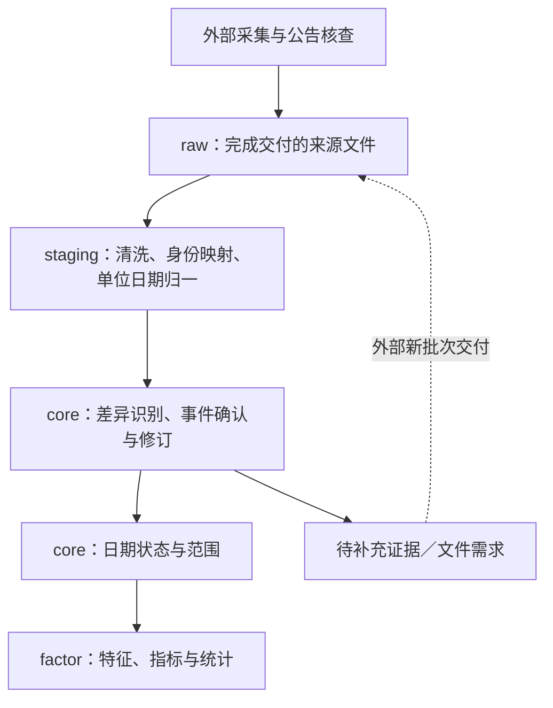

# MarketDB 四层事件、状态与业务流程范式

状态：当前架构讨论稿；2026-10-05。

[文档入口](README.md) · [生命周期矩阵](lifecycle-tracking-matrix.md) · [每日能力矩阵](daily-cycle-capabilities.md)

本文定义 ST、上市／退市、复权等业务域共用的处理范式，并逐项展开流程。表名和字段为逻辑概念，不是 DDL；尚未创建库表或实现任务。

## 1. 核心结论与术语

每个事件域贯穿四层：raw 原始依据、staging 标准化候选、core 事件及日期状态、factor 结果，以及贯穿四层的专属业务流程。core 日期状态用于 factor 计算，可重建部分按保留策略清理；core 事件、必要变化依据与 raw 原始证据按各自合同保留，以支持状态恢复和重新标准化。

当前股票白名单是首要观察入口。每天既识别 ST 名单，也检查原有 ST 证券在完整目录中的当前表现。仅扫描当天 ST 子集、仅比较更新时间，无法区分正常名称、来源遗漏、停牌和退市。

术语纠正：证券名称不再带 ST/*ST，属于风险警示撤销的观察线索，通常称“摘帽”；交易所终止上市后摘牌是另一类生命周期事实。ST 类型变化如 *ST → ST，也应单独识别，不能当作完全解除风险警示。

停牌股票通常仍在当前目录中，也可能继续带 ST。目录缺失、ST 状态更新时间落后和零成交量均不能单独证明停牌或退市。目录变化可以立即用于当前观察状态和任务安排，但只有具备相应依据时，才能升级为正式生命周期事件。

## 2. 共用架构与入口

MarketDB 不运行 collector 或来源 CLI/API。以下流程提到的来源命令、交易所公告和交叉验证，均由外部生产端取得后交付 raw；MarketDB 内部核验只针对已导入证据。文件不完整时隔离或拒绝，缺口登记为外部补充交付需求。

staging 负责语法、代码和单位等归一，不直接判定摘帽、退市或应用复权事件。core 比较已标准化的观察与历史依据，区分观察变化、正式确认、更正和撤销。factor 只计算依赖就绪的结果。

## 3. 四层逻辑数据职责

| 层 | 事件域共用内容 | ST 示例 | 保留 |
| --- | --- | --- | --- |
| raw | 来源文件、公告／事件原始依据、日期范围、交付类型、文件摘要 | 全目录文件、ST 核对文件、正式风险警示文件 | 保留来源证据和重放所需版本 |
| staging | 清洗候选、身份映射、单位／日期归一、异常隔离及记录定位 | 名称标记解析，代码关联，完整性校验 | 可重建中间结果在任务完成后清理 |
| core | 稳定身份、标准观察变化、事件及有效时间、日期状态 | ST 实施／变更／撤销与 is_st 日状态 | 事件及必要变化长期保存；可重建日状态可短期保留 |
| factor | 规则计算与消费用结果 | 涨跌停、连板、风险分类横截面 | 按消费者历史合同保存 |
| 跨层管理 | 批次、规则版本、来源定位、核查、依赖与发布 | 哪批目录生成哪版状态与统计 | 覆盖追溯和恢复需要 |

ST、生命周期、复权保留独立事件域和专属业务内容，共享这条处理流程。证券按市场、代码与稳定身份关联，更名或换码不得直接推断为退市后新上市。状态属于 core，不再独立建立 Snapshot 层；快照仅指 core 状态或集合的某个版本。

## 4. 时间与确认语义

用户提出的“每日刷新 ST 状态更新时间”可保留，但需把下面几种时间分开，否则很难解释状态没有刷新的原因。

| 时间／版本 | 用途 |
| --- | --- |
| observed_at／last_seen_at | 最近一次实际看到该证券及对应名称的时间 |
| last_checked_at | 最近一次完成该范围完整检查的时间；检查后也可能发现证券缺失 |
| source_as_of／适用交易日 | 来源可确认对应的日期；不能直接用程序运行日期代替 |
| state_changed_at | 业务观察状态最近一次发生变化的时间；状态未变时不每天改写 |
| effective_at | 有依据的事件生效时间；未知时保持未知，不由首次发现时间伪造 |
| confirmed_at | 核查获得充分确认的时间；可能晚于事件生效日 |
| input_version／rule_version | 生成状态与 factor 使用的依据和规则版本 |

这些是语义要求，不要求每张表重复保存所有字段。每日成功观察到相同 ST 状态，只刷新观察／检查信息；不重复产生“实施 ST”事件。对当前非 ST 证券也必须记录有效检查，才能识别新进入 ST 的证券。

每项事实区分“观察到变化”“已确认”“被更正／撤销”。例如名称由 *ST 变普通名称，可以形成观察记录并更新当日名称识别状态；确认撤销风险警示的生效日后，再完成正式 ST 事件。两阶段关联同一变化，不能重复计算为两次业务事件。

## 5. 共用处理流程模板

每个事件域按以下合同定义自己的流程。

| 步骤 | 必须说明的内容 | 共同规则 |
| --- | --- | --- |
| 1. 定义对象与范围 | 证券身份、市场、日期、规则适用范围 | 明确检查整个目录还是局部集合 |
| 2. raw 导入与 staging 校验 | 来源文件、交付日期／类型、范围、代码映射、单位转换、重复与异常 | 外部获取失败和有效空文件必须区分；隔离后失去完整性的范围不做缺失推断 |
| 3. 识别候选变化 | 新观察与已有有效观察／事件的对比规则 | 新增、状态改变、消失、恢复、证据冲突分别处理 |
| 4. 记录观察和核查项 | 变化内容、来源、原状态、时间及证据 | 保留未知；不将疑似变成正式事实 |
| 5. 导入并核验确认依据 | 外部补交文件、权威来源、确认条件、有效日期 | 重复缺失仍只是缺失，不能靠累计天数自动确认退市 |
| 6. 写入或修订事件 | 事件身份、证据合并、更正关系 | 重跑幂等；同一事件多来源证据不形成多次经济事件 |
| 7. 生成日状态 | 给定日期、输入版本、未知与冲突处理 | core 日期状态从长期依据恢复；无变化也可刷新检查信息 |
| 8. 更新 factor | 哪些日期、证券、窗口、聚合受影响 | 发布输入／输出版本，避免新状态与旧结果混读 |
| 9. 重试与清理 | 未决任务、重试入口、快照到期条件 | 来源失败不覆盖有效历史；清理前验证可重建 |

“每天”是观察任务的运行频率，不代表每天有新事件，也不代表所有任务都应在休市日生成新的交易日状态。

## 6. ST 专属处理流程

### 输入与输出

staging 先映射证券身份、保留原名、解析风险类型，并核验交付范围是否完整；异常隔离会影响该范围的缺失判断资格。以下转移均由 core 执行。

raw 主输入：外部运行 `tdxman stock-codes --format json` 后交付的完整股票清单文件；`tdxman abnormal-list --type st` 可用于核对，但它来自同一目录，不算第二个独立证据源。历史事件、生效日核查由外部生产端取得交易所风险警示公告及公司正式披露后交付文件，当前尚未建立完整交付合同。

输出：core ST 事件／观察变化；core 当日 is_st、st_type、依据与可用性；受影响的涨跌停、连板和横截面重算任务。

### 转移规则

| 已有情况 | 本次完整有效观察 | 处理 | core 日期状态 |
| --- | --- | --- | --- |
| 尚无风险状态 | 明确 ST/*ST 名称 | 新增风险警示观察，核查正式实施日 | 适用日置 is_st=true，保存具体类型及观察依据 |
| 已有同类 ST | 仍为同类 ST | 刷新 last_seen／last_checked，不重复创建事件 | 保持状态并刷新新鲜度 |
| 已有 *ST | 改为 ST，或反向变化 | 记录类型变化，核查正式事件及有效日期 | 更新类型，不把 is_st 清零 |
| 已有 ST | 同一证券有效名称已不带风险标记 | 记录“疑似摘帽／名称风险标记解除”观察，核查撤销公告 | 当前名称观察可置非 ST，并标明确认程度；历史区间等待生效依据修正 |
| 已有 ST | 仍在目录，且有独立停牌依据 | ST 与停牌分别维护 | is_st 与 trading_status 可同时表示 ST 和停牌 |
| 已有 ST | 在完整成功的相应市场目录中缺失 | 记录目录缺失候选，转生命周期核查；保留最后已知 ST 事实 | 当日成员／风险适用性标未知，不能按缺失清除 ST |
| 任意状态 | 市场来源失败、名称缺失或不完整 | 登记失败，等待补采；不形成摘帽或退市事件 | 原状态保留为历史依据，当日新鲜度及就绪状态不足 |
| 已确认退市 | 本次没有当前目录记录 | 生命周期流程负责退出当前采集集合 | 不再每天为已退市证券制造未知交易状态；保留历史 ST |

ST 任务扫描完整目录与已有跟踪集合的并集。只看当日 ST 列表，会漏掉摘帽观察和目录缺失。更新时间过旧仅用于生成复查队列；随后必须检查完整目录、来源是否成功和独立停牌／退市依据。

组合标记解析保留原名。当前代码尚未实现全部组合形式，不能把现有简单前缀解析当作完备状态合同。

## 7. 上市／退市专属处理流程

### 输入与识别

文件先进入 raw；staging 统一证券身份、事件类型、来源日期及单位并隔离异常，core 仅对验收后的候选进行以下业务判断。

- 目录出现未知证券：立即创建身份和首次发现观察，无论是否带 N。
- N/C 等名称标记：记录上市阶段提示，核查上市日期；不将首次抓取日当上市日。
- 已有证券在完整目录中消失：记录成员缺失，检查市场源、换码、更名／身份对应及相关公告。
- 缺失证券重新出现：恢复目录成员观察；此前没有充分依据时，不制造“退市后重新上市”事件。

### 验证与事件

`tdxman symbol-info SYMBOL --source baostock`／`BaostockClient.get_stock_basic` 是现有沪深资料核查入口，不能覆盖所有市场和全部生命周期事件。外部生产端后续取得的权威核查文件优先来自交易所上市、终止上市及摘牌公告，并可用发行人披露和证监会资料交叉验证；证监会发行注册信息不单独证明股票已经开始交易或已经摘牌。

把“上市”“退市整理阶段”“终止上市决定”“摘牌”按所需业务含义分别记录。决定日、最后交易日和摘牌日不能合并推断。正式事件需要明确来源及相应日期；等待确认期间可停用当前目录候选成员，但不能伪造正式退市事件。

### core 日期状态与计算影响

由已确认上市日期、板别、会话和有效规则生成上市交易日序号及价格限制类别。无日期依据时，依赖新股阶段的计算保持未就绪。确认退市后限定当前采集范围，历史行情、风险事件与 factor 继续保存。

上市日或退市日被更正时，重建影响区间的成员／上市阶段 core 日期状态，并重算价格限制、连板及相关横截面集合。

## 8. 复权事件专属处理流程

### 输入与识别

文件先进入 raw；staging 统一证券身份、事件类型、来源日期及单位并隔离异常，core 仅对验收后的候选进行以下业务判断。

权威输入仍是 thsman 全历史股票经济事件；既有 `aspool.event_baseline.install(root, source)` 属于旧系统，不作为 MarketDB 入口；新方案经 raw 导入、staging 标准化后写 core，日常增量交付仍待实现。目录 XD/XR/DR 是当天权息处理的提示来源，触发核验，不独立生成完整经济事件。

对比新旧权威事件集合，识别新增、参数修订、撤销和生效日期调整；同一事件重复交付不重复应用。事件名称、金额、股本单位和币种必须按来源合同校验，未来生效事件不能提前影响价格。

### 对账处理

| 情况 | 处理 |
| --- | --- |
| 有目录标记，存在匹配权威事件 | 核对适用日与事件参数，生成当日公司行为状态 |
| 有标记，无可信事件参数 | 记录待核查项；可保留标记观察，不能仅凭标记生成因子 |
| 有有效权威事件，名称无标记 | 继续按事件处理并核查来源差异；不因缺少标记撤销事件 |
| 权威事件与有效来源参考价冲突 | 保留证据并核查；相关价格计算暂不发布确定结果 |
| 重复下载相同事件 | 刷新检查记录，不新增经济事件或无故重算 |
| 事件被更正或撤销 | 保存修订关系，识别历史影响范围并重建状态及结果 |

### core 日期状态与计算影响

core 日期状态保存当日权息类别、采用事件版本、计算参考价与校验结果。未复权前日收盘、来源当日参考昨收和事件调整值应在语义上区分；已调整的参考价不再次扣减分红。

复权事件改变后，重算受影响的因子、复权历史价格、技术指标和依赖价格尺度的结果。影响范围可能远大于事件当天；前复权基准改变也可能影响整段历史。目录临时标记消失只意味着不再观察到该日提示，不删除长期复权事件。

## 9. 跨域协同与异常处理

同一证券可以同时属于 ST、新股阶段、停牌和除权除息等不同维度。各流程写自己的事件依据，通过统一日期、证券身份及输入版本汇合成 core 日期状态。冲突由明确规则处理，不依赖谁最后写入覆盖谁。

来源完整性按市场、批次和日期判断。全市场任务部分失败时，不得把已成功市场的清单当作全市场完整清单；局部发布必须显式限定范围。一个字段缺证据不必抹去所有已知字段，但该字段依赖的 factor 必须反映不可用。

状态变化流程应支持以下最小情形：重复运行无重复事件；*ST 与 ST 转换；摘帽观察；停牌仍在目录；目录短暂缺失后恢复；确认退市；身份换码；未来事件；历史事件修订；来源失败；core 日期状态删除后的指定日期重建。

## 10. core 日期状态清理与恢复

最近检查时间不是唯一历史证据。日状态被销毁后，若 core 只保留“当前状态＋最新更新时间”，将无法恢复某个过去日期的 ST 或上市阶段。因此必须保留必要的状态变化、事件及其有效时间／观察时间依据；不需要把每天无变化的状态永久复制。

已确认事件可按有效时间投影。只有观察依据的历史区间，应标明观察覆盖及不确定性，不能无限向前或向后填充。无法重建的必要历史状态，应先将其来源事实纳入 core，再清理 core 日期状态。

core 日期状态可选择发布后 1／3 个月清理，但前提是关联任务与核查已处理、消费者不再引用、输入版本和规则可追溯、历史修订有重算路径。长期 factor 不随 core 日期状态到期一并销毁。

## 11. 后续每个事件域的文档模板

新增事件域时，按下面内容填写，不必重复建立新的架构体系：

1. **业务对象与事件类型**：识别谁、哪些变化属于事件、哪些仅为来源观察。
2. **raw 交付合同**：外部生产 CLI/API、文件格式、市场覆盖、来源日期、全量／增量／修订类型、单位、完整性及证据。
3. **staging 规则**：解析、清洗、身份映射、单位及时间转换、异常隔离和来源记录定位。
4. **core 事实与状态**：身份关联、事件、有效时间、观察及确认程度、修订关系、日期状态与未知值。
5. **转移矩阵**：旧状态×新标准观察→候选／确认事件→新状态，覆盖缺失、恢复、冲突和修订。
6. **运行流程**：文件触发、顺序、幂等、重试、补充交付需求、版本发布和失败边界。
7. **factor 影响**：消费者、输入依赖、影响日期／窗口、重算及发布方式。
8. **保留与验收**：分层清理条件、raw 重放和 core 状态重建方法，以及业务验证场景。

优先实现 ST 域作为第一条完整链路，验证“raw 目录文件 → staging 清洗归一 → core 风险事件与日状态 → factor 涨跌停计算”。上市／退市和复权沿同一范式扩展，各自保留专属来源、确认规则及时间语义。

## 12. 事件流程的物理发布模板

core 事件和日期状态采用版本化 Parquet，行情及热门 factor 结果采用 DuckDB 内部表。每个事件流程先写并校验新文件，再提交 DuckDB 中的有效文件引用、关联内部变更及发布状态；factor 基于固定 core 版本重算并单独发布。失败时未引用文件不能被消费者自动扫入，原有有效发布仍可识别。

ST 状态刷新、目录摘帽观察、生命周期确认和复权修订都通过新版本发布完成，不就地覆盖正在读取的 Parquet 文件。需要频繁随机更新的数据再按负载评估是否转内部表。模板中的运行与验收部分须涵盖文件已写但事务未提交、提交后 factor 未就绪，以及清理时仍有读者引用等情形。详见[存储与发布架构](storage-and-publication.md)。

## 13. 对照 AxData 补充的验收条件

事件处理任务须声明写入模式和影响范围；全量状态快照与事件增量采用不同缺失语义。关联 task/run/batch/release，验证重试不重复产生事件、迟到旧批次不覆盖新事实、隔离记录不被当作有效缺失。Dataset 已注册不等于事件或状态已发布；正式输出以发布及质量状态为准。相关决策见[AxData 对照](axdata-comparison.md)。
