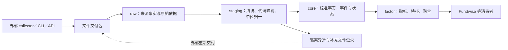

# MarketDB 四层逻辑架构

状态：当前设计讨论稿；2026-10-05。[文档入口](README.md)

## 1. 边界与数据流

MarketDB 按 **raw → staging → core → factor** 组织。collector 在系统边界之外负责采集和交付文件；MarketDB 只导入 Parquet、CSV、JSON 等 raw 文件，不调用 collector、行情 CLI 或远程 API。

四层是逻辑处理职责，不等于四个数据库文件。物理承载采用 [DuckDB＋Parquet](storage-and-publication.md)：标准历史行情与高频派生数据优先入 DuckDB，事件、目录、日历和日期状态采用版本化 Parquet，由 DuckDB 统一计算。管理记录贯穿四层，记录批次、来源、完整性、输入输出版本、任务和发布进度，不增加第五个业务层。

本轮统一替代先前“基础／Snapshot／Enriched”分层。原基础数据的原始依据归 raw，标准事实归 core；原状态库归 core；原 Enriched 归 factor。Snapshot 只表示可重建状态的某个日期或版本，不再是独立层。

## 2. 各层职责

| 层 | 保存内容 | 处理职责 | 下游约束 |
| --- | --- | --- | --- |
| raw | 来源文件、必要原始依据及交付描述 | 接收文件、校验交付完整性、登记批次与摘要 | 保持原始值，不在原文件上修正单位、名称或代码 |
| staging | 可重跑的标准化候选记录、映射结果及隔离记录 | 解析、清洗、代码映射、单位转换、重复检查和结构校验 | 异常不得悄悄删掉后宣称完整；保留 raw 行／记录定位 |
| core | 统一证券身份、目录、日历、标准未复权行情、基本面、事件、成员关系及状态 | 业务对账、事件确认与修订、日期状态投影、一致发布 | 是标准事实与状态权威；未知不填成正常，不混用日期语义 |
| factor | 本地复权因子／价格、量价指标、技术指标、涨跌停与横截面统计 | 按消费者合同计算、追踪依赖、重算和发布 | 只消费已发布 core 版本及明确依赖的 factor 版本，不绕过 core 读 raw |

raw 是来源事实的证据层，core 是统一后的业务事实层，二者有意保存不同表示。它们通过血缘相连，不作为两套可独立修改的业务权威。

## 3. raw 文件导入合同

支持格式不等于字段自动兼容。每个数据域需定义对应的交付结构和解析规则；文件格式、供应商格式版本及字符编码均须明确。CSV 证券代码按字符串读取，保留前导零；金额、成交量、股本、复权类型和币种不可凭列名猜单位。

一个交付包至少能表达以下语义，既可写在随附描述文件，也可由导入参数明确提供：

- 数据域、来源／生产程序、源接口标识、格式版本、文件列表和内容摘要。
- 市场／证券范围、来源有效日期或覆盖区间、实际观察时间及必要时区。
- 全量快照、增量、更正或撤销的交付类型，以及完成状态、行数／分页等可用的完整性依据。
- 原始单位、价格复权口径、代码命名空间及前置依赖。

文件写完并完成交付后才能导入。MarketDB 保存接受的不可变文件版本或受控归档副本，不依赖可能被生产端覆盖的路径。文件损坏、描述冲突、缺文件时拒绝接受或隔离该批次；不得以空目录替代有效全市场结果。

同一内容重复导入不重复产生业务事件。相同来源覆盖范围出现新内容，按新修订处理，不覆盖旧原始证据。摘要判文件重复，业务键和修订关系判业务重复，二者不能互相替代。

## 4. core 的逻辑数据域

| 数据域 | 标准事实与状态职责 |
| --- | --- |
| 证券身份与目录 | 市场＋代码映射到稳定身份；当前成员、名称、板别及必要变化依据 |
| 生命周期与风险事件 | 上市、终止上市、摘牌、ST 实施／变更／撤销、停复牌事实及修订 |
| 交易日历 | 市场会话与已确认覆盖；未来安排和已观测开市事实分别说明 |
| 未复权行情 | 股票、指数、ETF 的标准 OHLCV、金额及来源口径；保持资产差异 |
| 基本面与日期股本 | 报告期、统计日期、披露／获知时间及有效股本依据 |
| 股票复权事件与 ETF 来源因子 | 股票采用 thsman 事件交付；ETF 保留其独立真实来源 |
| 分类与历史成员依据 | 指数分类、板块成员集合与有效／观察版本 |
| 状态与计算范围 | ST、上市阶段、交易状态、权息状态、数据就绪、参考价依据和横截面集合 |

当前目录不是任意历史日的完整目录。历史回算所需的成员变化或集合依据必须保留。当天可计算状态和长期生命周期事实分别维护；退市不物理删除历史证券数据。

## 5. factor 的逻辑数据域

包括本地股票复权因子、前／后复权价格、量比、换手率、市值、MA／BIAS 等个股和指数技术指标、涨跌停／连板、市场与板块横截面统计。

因子、价格与技术指标可以形成 factor 内部的显式依赖链。例如 core 原始行情和事件 → factor 复权因子 → factor 复权价格 → factor MA。避免循环依赖；上游发生修订时按实际影响区间重算。

外部来源前复权价格作为 raw 成品交付，经过 staging 后可进入 core 的独立来源参考数据集用于对照；不能覆盖标准未复权行情，也不能冒充本地计算的 factor。是否长期保留该参考集由实际核验需求决定。

core 状态保存计算前提和适用性；消费者需要的涨跌停命中等业务结果归 factor。计算过程中可缓存命中位，但共用同一计算规则和版本，不能另建一套可写权威。

## 6. 发布、修订与失败

处理顺序：登记 raw → staging 校验与隔离 → core 对账并准备版本 → 发布 core → 标记受影响 factor 过期 → 重算并发布 factor。

core 与 factor 可以先后完成，但管理信息必须明确各自版本与就绪状态。消费者不得把未匹配版本当成一致结果。失败任务保留输入批次和原因，按批次重跑；网络补采由外部生产系统完成并重新交付文件。

全量目录的缺失推断只适用于已完整验收的明确市场／日期范围。staging 隔离了部分目录记录时，该范围不能继续声称完整。增量文件没出现某证券不表示其退出目录。

事件更正支持有效日期与实际获知日期分别追溯；严格历史时点回测仍需相应历史版本，不能仅凭最新 core 表宣称已支持。

## 7. 保留原则与落地顺序

raw 以证据和重新标准化需要确定保留；staging 成功发布后可清理可重建中间结果；core 长期事实与必要变化依据长期保留，可重建的日状态按窗口清理；factor 按 Fundwise 等消费者的历史要求保留。1／3 个月仅是 core 状态或中间缓存的候选策略，不是整层统一 TTL。

先定义目录 raw 交付合同，再实现 staging 身份与名称归一、core ST 观察／事件及日状态，最后打通 factor 涨跌停链路。字段字典、DDL、具体文件布局、导入 CLI 和调度实现留待后续；文中目标能力不表示已经实现。

## 8. 混合存储的发布约束

Parquet 先完成不可变文件写入和校验，再由 DuckDB 事务提交内部数据及其有效文件引用。正式计算固定 core 数据与文件版本；factor 另行发布并登记依赖。单一协调写入者处理跨存储失败恢复，消费者通过服务或版本发布件读取。完整约束见[存储与发布架构](storage-and-publication.md)。

## 9. 写入模式、质量和运行元数据

每个 Dataset 明确允许的写入模式，raw 文件合同声明本批的实际模式与覆盖范围；不设置“未声明就覆盖当前数据”的隐含默认值。

| 逻辑写入模式 | 必要条件 | 发布规则 |
| --- | --- | --- |
| append | 来源批次身份及重复文件识别 | 用于 raw 留痕；不等同于 core 允许重复业务键 |
| snapshot | 明确完整范围和适用时点 | 新版本替换该范围的有效集合，保留未涉及范围 |
| overwrite_partition | 明确分区及完整性 | 只替换验收分区的发布引用，不能直接删除正在读取的文件 |
| replace_range | 明确日期字段、闭区间和证券／市场范围 | 完整验收才替换；不能仅用返回行的最小／最大日期猜请求范围 |
| upsert_by_key | 稳定业务键及修订优先级 | 按有效来源修订处理冲突；不无条件采用最后到达行 |

质量分三处：raw 检查文件与交付范围；staging 检查必填、类型、业务键重复、代码／市场一致性、单位及数据有效性；core 检查事件、参考价和跨域覆盖。Dataset 明确哪些问题阻断发布，哪些可隔离并限范围发布，哪些仅警告。重复键值相同与相互冲突须分别处理。

管理记录关联 task（任务定义）、run（执行尝试）、batch（输入交付）、release（发布版本）。一个批次可以重试多次，一次执行可以发布多个资产；任务成功不自动证明每个目标资产完整。重放记录输入、标准化／算法版本、受影响范围、质量结果和输出引用。
