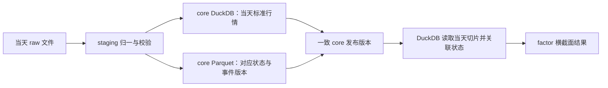

# MarketDB DuckDB＋Parquet 存储与发布架构

状态：已接受的架构方向，具体实现待设计；2026-10-05。

[文档入口](README.md) · [四层逻辑架构](logical-architecture.md)

## 1. 总体方案

采用 DuckDB 作为主要计算引擎和高频计算数据存储，结合 Parquet 承载事件、目录、日历和日期状态。逻辑四层与物理存储分别规划：raw → staging → core → factor 不等于四个独立数据库。

分配依据是更新方式、查询方式和发布方式。“独立业务域按批更新”适合版本化 Parquet；Parquet 文件本身不提供跨文件事务、唯一约束或行级更新。需要频繁随机修改或强一致联动的数据优先考虑 DuckDB 内部表。

DuckDB 统一关联内部行情表和已发布 Parquet 文件，通过同一计算入口生成 factor。Parquet 中的事件仍然参与核心计算，文件存储并不意味着其业务重要性较低。

## 2. 物理承载矩阵

| 逻辑归属／数据 | 首选承载 | 更新与查询方式 | 约束 |
| --- | --- | --- | --- |
| raw 原始交付 | 原格式 Parquet／CSV／JSON 等文件 | 完成批次接收，按内容版本登记 | 保留原始证据；不在原文件上做清洗或覆盖更正 |
| staging 清洗候选 | DuckDB 临时表或临时 Parquet | 按批转换、校验、隔离，支持重放 | 选择取决于批量大小及恢复需要；不形成独立业务权威 |
| core 标准未复权历史行情 | DuckDB 内部表 | 按证券和日期查询、修订，读取计算窗口 | 股票、指数、ETF 保留各自量额语义 |
| core 财务、股东及日期股本 | 暂优先 DuckDB 内部表 | 日期关联及历史修订 | 后续按实际消费负载验证；来源频率低不代表必须放文件 |
| core ST／上市退市／停复牌／复权事件 | 版本化 Parquet | 事件批次增加、更正、撤销，发布新逻辑版本 | 不依靠扫描全部文件直接累加事件；发布清单定义有效集合与修订规则 |
| core 当前目录、交易日历 | 版本化 Parquet | 小规模全量版本替换或明确范围更新 | 完整验收后发布；高频更新或并发需求变化时再评估内部表 |
| core 分类及成员关系 | 版本化 Parquet | 按成员集合及来源版本读取 | 保存必要历史集合，不能用当前成员覆盖历史依据 |
| core ETF 来源因子 | 版本化 Parquet | 来源批次维护、日期关联 | 区分外部来源因子与本地计算的 factor 因子 |
| core 日期状态与横截面集合 | 按日期／批次组织的 Parquet | 读取一天全市场状态，按影响日期修订 | 日期是逻辑范围，不要求每天每表一个小文件；清理需满足可重建条件 |
| core 外部复权参考数据（可选） | 版本化 Parquet | 核验、对照 | 明确来源尺度，不覆盖 NONE 行情或本地 factor |
| factor 本地因子、复权行情、热门指标及特征 | DuckDB 内部表 | 日期／证券关联、窗口运算与局部重算 | 由消费者合同明确历史范围及价格基准 |
| factor 市场与板块统计 | DuckDB 内部表 | 日级范围查询及历史修订 | 固定输入集合、状态、规则和发布版本 |
| factor 发布件／历史归档 | Parquet | 独立消费、交换、归档 | 是指定结果版本的发布副本，不能回写成为第二套计算权威 |
| 管理：批次、任务、发布清单及就绪状态 | DuckDB 管理表 | 由协调写入者提交版本和依赖状态 | 文件内容提交与数据库事务并非天然原子，需要下面的发布协议 |

分区粒度、排序、压缩和缓存按实际数据规模与查询验证，不预先为每只证券拆小文件。对热点 Parquet 可建立可重建的 DuckDB 缓存，但权威归属、失效与更新规则必须单一。

## 3. Parquet 更新与事务边界

事件追加不等于永远不修订。新增事件可形成新文件，更正和撤销必须有事件身份、来源版本及有效集合规则。当前目录、日历或某日状态发生变化时，写出新版本，再替换发布清单中的有效引用；不直接覆盖读者可能正在使用的文件。

推荐单一协调写入流程：

1. 固定本次 raw 批次与前置发布版本，完成 staging 校验。
2. 写入新的不可变 Parquet 文件，关闭写入并检查摘要、行数、范围和可读性；失败文件不进入发布集合。
3. 在 DuckDB 事务中更新本次 core 内部表，并登记与其一致的 Parquet 文件列表、输入版本及发布状态。
4. 提交成功后该 core 版本可用；提交前消费者仍只使用上一发布版本。事务失败时新文件未被引用，可重试或后续回收。
5. factor 读取固定 core 视图计算，将结果及依赖版本在单独发布步骤中提交；中间阶段明确标记旧 factor 与新 core 不匹配。
6. 后续回收未引用文件；不能删除活跃读者、已保留发布版本或待重建任务引用的文件。

发布清单管理的是准确文件集合，而不是一个随时变化的目录通配符。仅记录文件路径不够，还需验证引用内容不可变。数据库事务不会替外部文件完成耐久性或原子性保障；文件完成后再提交引用，恢复任务处理“文件已写但数据库未提交”等中间状态。

## 4. 读取一致性与 Fundwise

建议由一个写入服务协调 DuckDB 与文件版本发布，消费者通过服务读取，或消费明确版本的 Parquet 发布件。常规 DuckDB 读写并发以单写进程内的多线程为主要使用方式，不能假设 Fundwise 等独立进程随时直接打开正在写入的库文件。

服务读取在一致的数据库读取快照中解析发布清单，并读取其中固定版本的 Parquet。内部表若采用原地修订，单靠旧发布编号不能回读已覆盖的数据；需要历史结果的消费者使用已保留的发布件，或后续另行设计版本表。不能承诺一个发布编号自动提供永久历史快照。

历史重算可读取当前纠正后的事实；严格复现旧结果还要求旧输入、规则与计算版本可用，两种需求分别定义。

## 5. 每日横截面计算

正式横截面结果使用已清洗、验收并发布的 core 数据，不直接以当天 raw 文件为业务输入。当天 raw 仍是增量来源：

这不要求每日扫描全部历史：涨跌幅、涨跌停分布读取当天切片及所需参考依据；量比、连板、MA、BIAS 另外读取各自历史窗口。按证券与日期筛选的布局应以真实查询验证。

staging 可生成导入核对统计或临时预览，但不能把未经 core 验收的结果发布成正式 factor。否则当天统计与历史重算会因单位、重复、状态或成员范围不同而产生两套口径。

## 6. 清理、恢复与验证事项

raw、临时 staging、core 长期事件、core 可重建状态、factor 历史和发布副本分别制定保留规则。状态采用 1／3 个月窗口前，确认长期依据足以恢复、核查与重算已完成且无版本引用。

实现前验证：行情导入及历史修订、DuckDB 与状态 Parquet 的关联查询、整份目录版本更新、ST／复权事件幂等、提交前后失败恢复、并发读取期间文件保留、core/factor 不同就绪阶段，以及 Fundwise 的实际读取方式。性能收益须实测，不因使用某种格式就宣称更快。

当前只确定承载方向与一致性合同，尚未冻结 schema、文件分区、服务接口或迁移计划。

## 7. 技术依据

- [DuckDB Parquet 支持](https://duckdb.org/docs/stable/data/parquet/overview)：直接查询 Parquet，并支持列裁剪和过滤下推。
- [DuckDB 并发模型](https://www.duckdb.org/docs/current/connect/concurrency)：常规写入并发与进程边界。
- [DuckDB Parquet 布局建议](https://www.duckdb.org/docs/current/data/parquet/tips)：文件及行组布局需要结合查询、过滤与并行读取选择。

## 8. 正式数据备份与恢复

与 AxData 的 Parquet 全量权威模式不同，MarketDB 的行情和 factor 内部表属于正式数据，不能把整个 DuckDB 文件作为可丢弃缓存。备份需覆盖一致的数据库状态、其发布清单引用的不可变 Parquet、schema／规则版本及必要管理元数据；不在数据库活跃写入时直接复制文件充当一致备份。

恢复后验证文件摘要、引用完整性、core/factor 版本匹配与查询结果。只有确认 raw、规则、身份映射和事件修订依据足够时，才可把重建作为某个数据集的恢复方案；它不能自动替代全部备份。具体备份工具、周期与恢复时间目标待实施阶段确定。
